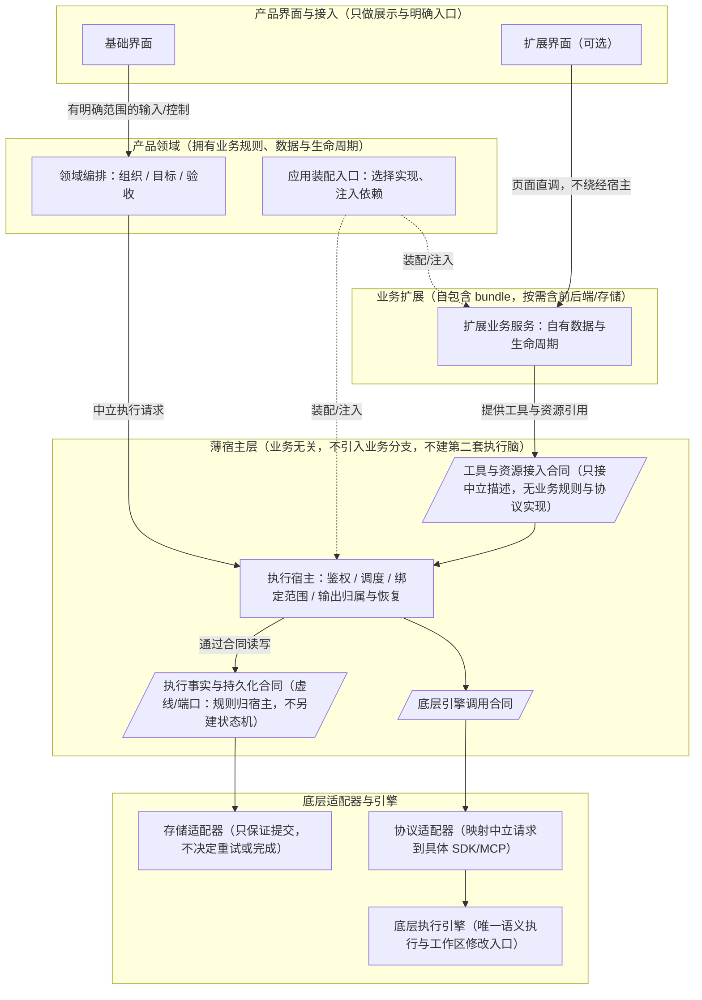

# 好的分层架构图范式（提炼自 `autodev-core`）

本样例展示“什么是一张能帮人 2 分钟砍掉多余依赖的好架构图”。学习的是**分层方式、合同边界、真相归属和禁止项写法**，在其他项目中按实际领域替换名词即可。

## 范式样例

> **主轴**：围绕底层执行引擎构建**业务无关的薄宿主**；业务状态与变化留在产品层和扩展层。
> *注：图中区域表示职责边界，不限定目录、进程或部署单元，不要求逐框新建模块。*

## 这张图为什么好（可直接照此自检）

1. **主轴明确，一眼分清“变”与“不变”**
   - 正常业务变化优先在薄宿主外（产品层/扩展层）完成；确需改薄宿主，必须先证明存在“业务无关的通用合同缺口”。
2. **每个关键节点都写了“不做什么”**
   - 薄宿主：不引入业务分支、不叠加第二套推理/自愈逻辑；
   - 存储适配器：只保证提交，不决定业务重试或完成；
   - 接入合同：只接收中立描述，不含业务规则或具体协议实现；
   - 扩展界面：直调扩展后端，不必经过宿主中转。
3. **状态真相归属无歧义**
   - 业务数据归产品领域；执行过程事实归宿主；扩展业务数据归扩展自身；彼此不伪装、不跨层复制状态机。
4. **把“装配”从“运行时调用”拆开**
   - 用虚线/独立装配入口表明依赖注入方向，避免运行时核心反向依赖具体业务实现。

## 常见烂图反例（避免）

- **只画组件名词 + 裸箭头**：`Frontend -> Console -> Core -> DB`，看不出谁拥有状态、谁不该知道什么，等于没画。
- **把原型装饰当成架构约束**：为了页面上一个未确认的聚合数字，画出跨服务轮询、镜像表或额外同步链路。
- **混用“物理部署”和“职责边界”**：把不同职责硬塞进一个服务框，或为了画图好看凭空拆出不需要的中间件。
